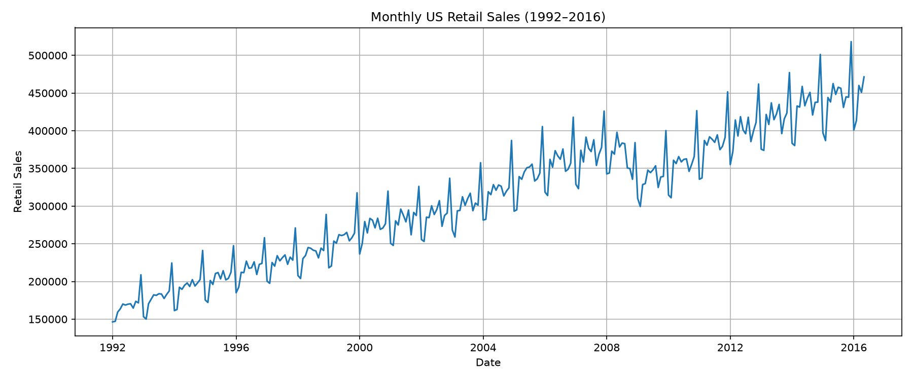
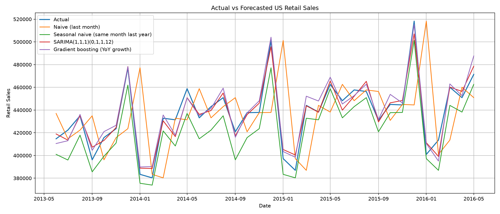

# US Retail Sales Forecasting

A time-series forecasting project comparing statistical and machine learning approaches to predict monthly US retail sales using walk-forward validation.

## Overview

This project implements and evaluates four forecasting methods:

- Naive Forecasting
- Seasonal Naive Forecasting
- SARIMA
- Gradient Boosting Regression

The objective is to compare simple forecasting baselines with advanced statistical and machine learning models on historical US retail sales data.

## Dataset

- **Source:** [Facebook Prophet GitHub Repository](https://raw.githubusercontent.com/facebook/prophet/main/examples/example_retail_sales.csv)
- **Frequency:** Monthly
- **Period:** January 1992 – May 2016
- **Observations:** 293
- **Target Variable:** Retail Sales

## Methodology

Used one-month-ahead walk-forward validation over the final 36 months (June 2013 – May 2016).

For each test month, models were trained using only historical observations available before that month to prevent data leakage.

### Models Implemented

1. **Naive Forecasting:** Uses the previous month's sales as the next month's prediction.
2. **Seasonal Naive Forecasting:** Uses sales from the same month in the previous year.
3. **SARIMA:** Seasonal ARIMA model with parameters SARIMA(1,1,1)(0,1,1,12).
4. **Gradient Boosting:** Predicts year-over-year log growth using engineered historical features and converts predicted growth back into sales values.

## Model Performance

Models were evaluated using Mean Absolute Percentage Error (MAPE) and Root Mean Squared Error (RMSE).

| Model | MAPE (%) | RMSE |
|---|---:|---:|
| SARIMA(1,1,1)(0,1,1,12) | 1.30 | 6,944 |
| Gradient Boosting (YoY Growth) | 1.44 | 7,575 |
| Seasonal Naive | 3.23 | 15,522 |
| Naive | 6.70 | 41,451 |

SARIMA achieved the lowest forecasting error, with Gradient Boosting performing closely. Both advanced models outperformed the seasonal naive baseline.

## Visualizations

### Historical US Retail Sales (1992–2016)



### Actual vs Forecasted Sales



## Technologies Used

- **Language:** Python
- **Data Processing:** Pandas, NumPy
- **Machine Learning:** Scikit-learn
- **Statistical Forecasting:** Statsmodels
- **Visualization:** Matplotlib
- **Development Environment:** Jupyter Notebook

## Project Structure

```text
retail-sales-forecasting/
│
├── forecast_retail_sales.py
├── forecast_retail_sales.ipynb
├── forecast_vs_actual.csv
├── model_metrics.csv
├── sales_history.png
├── forecast_comparison.png
├── requirements.txt
├── README.md
└── .gitignore
```

## Limitations

- Uses one aggregate national sales series rather than store-level or product-category data.
- Evaluation covers only one 36-month test window.
- Model parameters were selected once and not tuned.
- Only one-month-ahead forecasting was evaluated.
- Results may not generalize to other retailers or markets.

## Future Improvements

- Incorporate promotional, pricing, and holiday-related variables.
- Evaluate longer forecasting horizons.
- Experiment with additional forecasting models.
- Extend the analysis to individual retail categories and markets.
- Explore interactive forecast visualizations using Power BI.

## Author

**Vishal Vaibhav**
